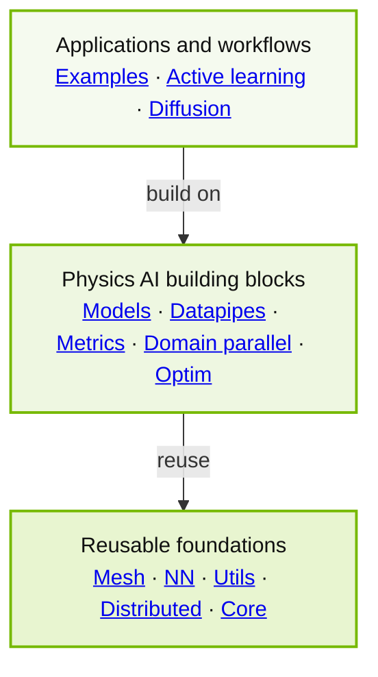

> **번역 정보** — NVIDIA PhysicsNeMo 저장소 메인 README의 한국어 번역입니다. 원문 확인일은 2026년 11월 9일이며, 기준 커밋은 `7d23f081f7e5ab88b83a1205e98ddade3a1a984b`입니다. 명령어·모델명·설정 키는 원문을 유지했습니다. 상태 배지는 항목별 링크로 옮겼고, 활용 그림은 펼쳐보기로 배치했으며, 구성도는 한국어로 재구성했습니다. 추가 설명은 **역자 주**로 구분합니다.
>
> [기준 버전 원문](https://github.com/NVIDIA/physicsnemo/blob/7d23f081f7e5ab88b83a1205e98ddade3a1a984b/README.md) · [최신 저장소](https://github.com/NVIDIA/physicsnemo) · [번역 Markdown](content/physicsnemo-main/README.ko.md) · [원문 사본](content/physicsnemo-main/README.original.md) · [Apache 2.0 라이선스 전문](content/physicsnemo-main/LICENSE.txt)

**PyTorch로 물리 AI 모델을 만들고, 학습하고, 규모를 확장하세요.**

[PyPI 패키지](https://pypi.org/project/nvidia-physicsnemo/) · [월간 다운로드](https://pepy.tech/projects/nvidia-physicsnemo) · [공식 문서](https://docs.nvidia.com/physicsnemo/latest/) · [설치 CI](https://github.com/NVIDIA/physicsnemo/actions/workflows/install-ci.yml) · [코드 커버리지](https://app.codecov.io/gh/NVIDIA/physicsnemo) · [라이선스](https://github.com/NVIDIA/physicsnemo/blob/7d23f081f7e5ab88b83a1205e98ddade3a1a984b/LICENSE.txt)

[문서](https://docs.nvidia.com/physicsnemo/latest/) · [예제](https://github.com/NVIDIA/physicsnemo/blob/7d23f081f7e5ab88b83a1205e98ddade3a1a984b/examples/README.md) · [모델](https://docs.nvidia.com/physicsnemo/latest/physicsnemo/api_models.html) · [블로그](https://nvidia.github.io/physicsnemo/blog/) · [토론](https://github.com/NVIDIA/physicsnemo/discussions) · [기여 안내](https://github.com/NVIDIA/physicsnemo/blob/7d23f081f7e5ab88b83a1205e98ddade3a1a984b/CONTRIBUTING.md)

NVIDIA PhysicsNeMo는 물리 머신러닝(physics ML), 과학 머신러닝(SciML), 과학·공학을 위한 AI에 사용하는 **오픈소스 PyTorch 프레임워크**입니다. 재사용 가능한 라이브러리 구성요소와 처음부터 끝까지 이어지는 학습 예제를 제공합니다.

```bash
pip install "nvidia-physicsnemo[cu13]"
```

위 명령은 CUDA 13 백엔드를 선택합니다. CUDA 12, 기본 설치, 선택 기능, 소스 코드 설치는 [설치 옵션](#main-section-07)을 참고하세요.

## PhysicsNeMo 활용 사례

### 공기역학

<details class="translation-image"><summary>공기역학 예제 그림 보기</summary><figure><a href="https://github.com/NVIDIA/physicsnemo/tree/7d23f081f7e5ab88b83a1205e98ddade3a1a984b/examples/cfd/external_aerodynamics/active_learning_aero"></a><figcaption>출처: NVIDIA PhysicsNeMo · 기준값과 GeoTransolver 예측값: 학습에서 제외한 ShiftSUV의 압력·벽 전단응력</figcaption></figure></details>

[통합 외부 공력](https://github.com/NVIDIA/physicsnemo/tree/7d23f081f7e5ab88b83a1205e98ddade3a1a984b/examples/cfd/external_aerodynamics/unified_external_aero_recipe): 현재의 표면·체적 모델을 학습하고 비교합니다.

### 기상 예측

<details class="translation-image"><summary>기상 예측 예제 그림 보기</summary><figure><a href="https://github.com/NVIDIA/physicsnemo/tree/7d23f081f7e5ab88b83a1205e98ddade3a1a984b/examples/weather/regional_weather_diffusion"></a><figcaption>출처: NVIDIA PhysicsNeMo · StormCast 예측과 고해상도 기상 분석의 비교</figcaption></figure></details>

[StormCast](https://github.com/NVIDIA/physicsnemo/tree/7d23f081f7e5ab88b83a1205e98ddade3a1a984b/examples/weather/regional_weather_diffusion): 생성형 지역 기상 예측.

### 반도체 패키징

<details class="translation-image"><summary>반도체 패키징 예제 그림 보기</summary><figure><a href="https://github.com/NVIDIA/physicsnemo/tree/7d23f081f7e5ab88b83a1205e98ddade3a1a984b/examples/cfd/underfill_dispensing"></a><figcaption>출처: NVIDIA PhysicsNeMo · 전진하는 에폭시 계면의 GeoTransolver 예측과 CFD 시뮬레이션</figcaption></figure></details>

[언더필 도포](https://github.com/NVIDIA/physicsnemo/tree/7d23f081f7e5ab88b83a1205e98ddade3a1a984b/examples/cfd/underfill_dispensing): GeoTransolver로 시간에 따른 에폭시 계면을 예측합니다.

### 구조역학

<details class="translation-image"><summary>구조역학 예제 그림 보기</summary><figure><a href="https://github.com/NVIDIA/physicsnemo/tree/7d23f081f7e5ab88b83a1205e98ddade3a1a984b/examples/structural_mechanics/crash"></a><figcaption>출처: NVIDIA PhysicsNeMo · 차량 전체 충돌 변형의 유한요소 시뮬레이션과 PhysicsNeMo 예측</figcaption></figure></details>

[충돌 동역학](https://github.com/NVIDIA/physicsnemo/tree/7d23f081f7e5ab88b83a1205e98ddade3a1a984b/examples/structural_mechanics/crash): 변형하는 메시에서 시간에 따른 응답을 예측하는 대리모델.

### 지구물리

<details class="translation-image"><summary>지구물리 예제 그림 보기</summary><figure><a href="https://github.com/NVIDIA/physicsnemo/tree/7d23f081f7e5ab88b83a1205e98ddade3a1a984b/examples/geophysics/diffusion_fwi"></a><figcaption>출처: NVIDIA PhysicsNeMo · 물리 정보를 반영한 확산 FWI의 기준값·앙상블 샘플·앙상블 평균</figcaption></figure></details>

[Diffusion FWI](https://github.com/NVIDIA/physicsnemo/tree/7d23f081f7e5ab88b83a1205e98ddade3a1a984b/examples/geophysics/diffusion_fwi): 가이던스를 사용하는 생성형 전체 파형 역산.

### 의료

<details class="translation-image"><summary>의료 예제 그림 보기</summary><figure><a href="https://github.com/NVIDIA/physicsnemo/tree/7d23f081f7e5ab88b83a1205e98ddade3a1a984b/examples/healthcare/bloodflow_1d_mgn"></a><figcaption>출처: NVIDIA PhysicsNeMo · 환자별 혈관 중심선을 따른 MeshGraphNet과 기준 압력·유량 물리장</figcaption></figure></details>

[심혈관 유동](https://github.com/NVIDIA/physicsnemo/tree/7d23f081f7e5ab88b83a1205e98ddade3a1a984b/examples/healthcare/bloodflow_1d_mgn): MeshGraphNet을 활용한 축소 차수 예측.

### 데이터센터 열 설계

<details class="translation-image"><summary>데이터센터 열 설계 예제 그림 보기</summary><figure><a href="https://github.com/NVIDIA/physicsnemo/tree/7d23f081f7e5ab88b83a1205e98ddade3a1a984b/examples/cfd/datacenter"></a><figcaption>출처: NVIDIA PhysicsNeMo · 데이터센터 고온 통로 내부의 시간에 따른 온도장</figcaption></figure></details>

[데이터센터 기류](https://github.com/NVIDIA/physicsnemo/tree/7d23f081f7e5ab88b83a1205e98ddade3a1a984b/examples/cfd/datacenter): 3차원 U-Net 대리모델로 온도와 기류를 실시간 예측합니다.

### 적층 제조

<details class="translation-image"><summary>적층 제조 예제 그림 보기</summary><figure><a href="https://github.com/NVIDIA/physicsnemo/tree/7d23f081f7e5ab88b83a1205e98ddade3a1a984b/examples/additive_manufacturing/sintering_physics"></a><figcaption>출처: NVIDIA PhysicsNeMo · 나선형 금속 부품의 소결 변형과 변위 크기 예측</figcaption></figure></details>

[금속 소결](https://github.com/NVIDIA/physicsnemo/tree/7d23f081f7e5ab88b83a1205e98ddade3a1a984b/examples/additive_manufacturing/sintering_physics): 그래프 기반 변형 예측.

위 그림은 모두 PhysicsNeMo 예제 또는 워크플로에서 가져왔습니다.

> **역자 주 — 구조해석 자료:** [앞서 번역한 자동차 충돌 해석 예제](blog.html?post=physicsnemo-crash-ko)에서는 이 가운데 충돌 동역학의 데이터 전처리, 학습·추론과 평가 절차를 더 자세히 볼 수 있습니다.

## PhysicsNeMo를 사용하는 이유

- **PyTorch 기반이며 조합하기 쉽습니다.** 기존 PyTorch 작업 흐름을 바꾸지 않고도 완성된 아키텍처, 개별 레이어, 수치 연산자 또는 데이터 변환을 사용할 수 있습니다.
- **과학 데이터의 표현을 고려합니다.** 규칙 격자, 메시, 점군, 그래프, 중첩된 물리장을 원래 구조를 유지하면서 다룹니다.
- **샘플 자체의 규모를 확장합니다.** `ShardTensor` 영역 병렬화를 사용하면 고해상도 샘플 하나를 여러 GPU로 나누어 처리할 수 있습니다. PyTorch의 DistributedDataParallel(DDP)이나 Fully Sharded Data Parallel 2(FSDP2)와 함께 사용할 수 있습니다.

## 예제 살펴보기

예제에서 시작해 자신의 데이터, 형상, 물리 문제와 배포 제약에 맞게 수정하세요. 물리 분야별 시작점은 다음과 같습니다.

- **공학 설계·전산유체역학(CFD):** [통합 외부 공력 예제](https://github.com/NVIDIA/physicsnemo/tree/7d23f081f7e5ab88b83a1205e98ddade3a1a984b/examples/cfd/external_aerodynamics/unified_external_aero_recipe)로 표면·체적 모델을 학습하고 비교하거나, [데이터센터 기류](https://github.com/NVIDIA/physicsnemo/tree/7d23f081f7e5ab88b83a1205e98ddade3a1a984b/examples/cfd/datacenter) 예제로 예측을 가속합니다.
- **날씨·기후·물:** [기상 예제](https://github.com/NVIDIA/physicsnemo/tree/7d23f081f7e5ab88b83a1205e98ddade3a1a984b/examples/weather)로 전 지구 예측을 구성하거나 [홍수](https://github.com/NVIDIA/physicsnemo/tree/7d23f081f7e5ab88b83a1205e98ddade3a1a984b/examples/weather/flood_modeling)를 예측합니다.
- **구조·제조:** [변형하는 구조물](https://github.com/NVIDIA/physicsnemo/tree/7d23f081f7e5ab88b83a1205e98ddade3a1a984b/examples/structural_mechanics/deforming_plate)의 거동을 모사합니다.
- **지구물리·지하 시스템:** [저류층 대리모델](https://github.com/NVIDIA/physicsnemo/tree/7d23f081f7e5ab88b83a1205e98ddade3a1a984b/examples/reservoir_simulation)을 구성합니다.
- **의료:** [뇌 이상 탐지](https://github.com/NVIDIA/physicsnemo/tree/7d23f081f7e5ab88b83a1205e98ddade3a1a984b/examples/healthcare/brain_anomaly_detection)를 수행합니다.
- **생성형·역문제 물리:** [확산 도구 모음](https://docs.nvidia.com/physicsnemo/latest/physicsnemo/api_diffusion.html)과 [위상 생성 예제](https://github.com/NVIDIA/physicsnemo/tree/7d23f081f7e5ab88b83a1205e98ddade3a1a984b/examples/generative/topodiff)를 조합합니다.
- **시뮬레이션·데이터 반복 과정:** [능동 학습](https://github.com/NVIDIA/physicsnemo/tree/7d23f081f7e5ab88b83a1205e98ddade3a1a984b/examples/active_learning)으로 새로 수행할 시뮬레이션을 선택합니다.

사용 가능한 전체 예제는 [전체 예제 목록](https://github.com/NVIDIA/physicsnemo/blob/7d23f081f7e5ab88b83a1205e98ddade3a1a984b/examples/README.md)에서 확인하세요.

### PhysicsNeMo 생태계

PhysicsNeMo는 재사용 가능한 모델, 학습 구성요소와 예제를 제공합니다. 특정 분야의 응용 계층이나 데이터 준비가 필요하다면 다음 프로젝트로 이어갈 수 있습니다.

| 필요한 작업 | 함께 볼 프로젝트 |
| --- | --- |
| **과학 데이터 준비** | [PhysicsNeMo Curator](https://github.com/NVIDIA/physicsnemo-curator): 과학·공학 데이터를 AI 학습용으로 준비하는 추출·변환·적재(ETL) 파이프라인 |
| **공학 추론·설계** | [PhysicsNeMo CFD](https://github.com/NVIDIA/physicsnemo-cfd): 추론, 평가, 벤치마크와 설계 작업 흐름 |
| **날씨·기후** | [Earth2Studio](https://github.com/NVIDIA/earth2studio): AI 날씨·기후 작업 흐름의 구축과 배포 |
| **원자 수준 시뮬레이션** | [NVIDIA ALCHEMI Toolkit](https://github.com/NVIDIA/nvalchemi-toolkit): GPU 중심 학습·추론·동역학 작업 흐름. [ALCHEMI Toolkit Ops](https://github.com/NVIDIA/nvalchemi-toolkit-ops)의 최적화된 기본 연산을 활용 |

## 모델 계열 선택하기

PhysicsNeMo 모델은 일반적인 `torch.nn.Module` 객체입니다. 데이터 표현과 해결할 작업에 따라 모델 계열을 선택하세요. 모델명은 소스 코드로 연결되며, 마지막 열은 예제와 논문을 안내합니다.

### 대리모델과 동역학

| 모델 계열 | 데이터 표현 | 활용 분야와 시작점 |
| --- | --- | --- |
| [FNO](https://github.com/NVIDIA/physicsnemo/tree/7d23f081f7e5ab88b83a1205e98ddade3a1a984b/physicsnemo/models/fno) / [DPOT](https://github.com/NVIDIA/physicsnemo/tree/7d23f081f7e5ab88b83a1205e98ddade3a1a984b/physicsnemo/models/dpot) | 규칙적인 직교 격자. DPOT는 시간·이력 축을 추가합니다. | 신경망 PDE 연산자와 자기회귀 동역학: [FNO Darcy 유동](https://github.com/NVIDIA/physicsnemo/tree/7d23f081f7e5ab88b83a1205e98ddade3a1a984b/examples/cfd/darcy_fno), [DPOT 논문](https://arxiv.org/abs/2403.03542) |
| [MeshGraphNet](https://github.com/NVIDIA/physicsnemo/tree/7d23f081f7e5ab88b83a1205e98ddade3a1a984b/physicsnemo/models/meshgraphnet) / [VFGN](https://github.com/NVIDIA/physicsnemo/tree/7d23f081f7e5ab88b83a1205e98ddade3a1a984b/physicsnemo/models/vfgn) | 비정형 메시의 절점·간선 그래프 | 메시 동역학과 축소 차수 시뮬레이션: [차량 충돌](https://github.com/NVIDIA/physicsnemo/tree/7d23f081f7e5ab88b83a1205e98ddade3a1a984b/examples/structural_mechanics/crash), [심혈관 유동](https://github.com/NVIDIA/physicsnemo/tree/7d23f081f7e5ab88b83a1205e98ddade3a1a984b/examples/healthcare/bloodflow_1d_mgn), [금속 소결](https://github.com/NVIDIA/physicsnemo/tree/7d23f081f7e5ab88b83a1205e98ddade3a1a984b/examples/additive_manufacturing/sintering_physics) |
| [Transolver](https://github.com/NVIDIA/physicsnemo/tree/7d23f081f7e5ab88b83a1205e98ddade3a1a984b/physicsnemo/models/transolver) / [FLARE](https://github.com/NVIDIA/physicsnemo/tree/7d23f081f7e5ab88b83a1205e98ddade3a1a984b/physicsnemo/models/flare) | 점 집합과 정형·비정형 이산화 데이터 | 큰 이산화 문제의 PDE 대리모델: [Darcy 유동](https://github.com/NVIDIA/physicsnemo/tree/7d23f081f7e5ab88b83a1205e98ddade3a1a984b/examples/cfd/darcy_transolver), [외부 공력](https://github.com/NVIDIA/physicsnemo/tree/7d23f081f7e5ab88b83a1205e98ddade3a1a984b/examples/cfd/external_aerodynamics/unified_external_aero_recipe) |
| [GeoTransolver](https://github.com/NVIDIA/physicsnemo/tree/7d23f081f7e5ab88b83a1205e98ddade3a1a984b/physicsnemo/models/geotransolver) | 형상과 전역 문맥을 함께 사용하는 점군 또는 정형·비정형 격자 | 형상을 고려한 CAE: [외부 공력](https://github.com/NVIDIA/physicsnemo/tree/7d23f081f7e5ab88b83a1205e98ddade3a1a984b/examples/cfd/external_aerodynamics/unified_external_aero_recipe), [언더필 도포](https://github.com/NVIDIA/physicsnemo/tree/7d23f081f7e5ab88b83a1205e98ddade3a1a984b/examples/cfd/underfill_dispensing) |
| [DoMINO](https://github.com/NVIDIA/physicsnemo/tree/7d23f081f7e5ab88b83a1205e98ddade3a1a984b/physicsnemo/models/domino) | 형상 점, 샘플링한 표면·체적 물리장, 정형 부호 거리장(SDF) 격자 | 자동차 공력의 표면·체적 물리장 예측: [논문](https://arxiv.org/abs/2501.13350) |
| [FIGConvNet](https://github.com/NVIDIA/physicsnemo/tree/7d23f081f7e5ab88b83a1205e98ddade3a1a984b/physicsnemo/models/figconvnet) | 인수분해된 2차원 격자로 표현한 대규모 3차원 점군 | 3차원 CAE 물리장·스칼라 예측: [외부 공력](https://github.com/NVIDIA/physicsnemo/tree/7d23f081f7e5ab88b83a1205e98ddade3a1a984b/examples/cfd/external_aerodynamics/figconvnet), [차량 충돌](https://github.com/NVIDIA/physicsnemo/tree/7d23f081f7e5ab88b83a1205e98ddade3a1a984b/examples/structural_mechanics/crash) |
| [GLOBE](https://github.com/NVIDIA/physicsnemo/tree/7d23f081f7e5ab88b83a1205e98ddade3a1a984b/physicsnemo/experimental/models/globe) — 실험 단계, API 변경 가능 | 경계 메시와 임의의 질의점 | 경계에 의해 결정되는 PDE와 대규모 형상의 CAE: [외부 공력](https://github.com/NVIDIA/physicsnemo/tree/7d23f081f7e5ab88b83a1205e98ddade3a1a984b/examples/cfd/external_aerodynamics/unified_external_aero_recipe), [논문](https://arxiv.org/abs/2511.15856) |
| [AeroJEPA](https://github.com/NVIDIA/physicsnemo/tree/7d23f081f7e5ab88b83a1205e98ddade3a1a984b/physicsnemo/experimental/models/aerojepa) — 실험 단계, API 변경 가능 | 3차원 표면 점군, 작동 조건, 질의점 | 공력 표현 학습과 물리장 예측: [튜토리얼](https://github.com/NVIDIA/physicsnemo/tree/7d23f081f7e5ab88b83a1205e98ddade3a1a984b/examples/cfd/external_aerodynamics/aerojepa), [논문](https://arxiv.org/abs/2605.05586) |

### 날씨와 기후

| 모델 계열 | 데이터 표현 | 활용 분야와 시작점 |
| --- | --- | --- |
| [AFNO](https://github.com/NVIDIA/physicsnemo/tree/7d23f081f7e5ab88b83a1205e98ddade3a1a984b/physicsnemo/models/afno) | 규칙적인 2차원 물리장 | 전 지구 예측: [통합 기상 예제](https://github.com/NVIDIA/physicsnemo/tree/7d23f081f7e5ab88b83a1205e98ddade3a1a984b/examples/weather/unified_recipe) |
| [GraphCast](https://github.com/NVIDIA/physicsnemo/tree/7d23f081f7e5ab88b83a1205e98ddade3a1a984b/physicsnemo/models/graphcast) | 위도·경도 물리장과 다중 규모 정이십면체 메시 그래프 | 전 지구 자기회귀 예측: [예제](https://github.com/NVIDIA/physicsnemo/tree/7d23f081f7e5ab88b83a1205e98ddade3a1a984b/examples/weather/graphcast), [논문](https://arxiv.org/abs/2212.12794) |
| [Pangu-Weather](https://github.com/NVIDIA/physicsnemo/tree/7d23f081f7e5ab88b83a1205e98ddade3a1a984b/physicsnemo/models/pangu) / [FengWu](https://github.com/NVIDIA/physicsnemo/tree/7d23f081f7e5ab88b83a1205e98ddade3a1a984b/physicsnemo/models/fengwu) | 여러 고도 수준의 위도·경도 격자 | 전 지구 중기 예측: [Pangu-Weather 예제](https://github.com/NVIDIA/physicsnemo/tree/7d23f081f7e5ab88b83a1205e98ddade3a1a984b/examples/weather/pangu_weather), [FengWu 논문](https://arxiv.org/abs/2304.02948) |
| [DLWP](https://github.com/NVIDIA/physicsnemo/tree/7d23f081f7e5ab88b83a1205e98ddade3a1a984b/physicsnemo/models/dlwp) / [DLWP-HEALPix](https://github.com/NVIDIA/physicsnemo/tree/7d23f081f7e5ab88b83a1205e98ddade3a1a984b/physicsnemo/models/dlwp_healpix) | 육면체 구면 격자 또는 HEALPix 메시 | 전 지구 및 결합 예측: [DLWP](https://github.com/NVIDIA/physicsnemo/tree/7d23f081f7e5ab88b83a1205e98ddade3a1a984b/examples/weather/dlwp), [DLWP-HEALPix](https://github.com/NVIDIA/physicsnemo/tree/7d23f081f7e5ab88b83a1205e98ddade3a1a984b/examples/weather/dlwp_healpix) |

### 생성형 모델과 역문제 모델

| 모델 계열 | 데이터 표현 | 활용 분야와 시작점 |
| --- | --- | --- |
| [Diffusion U-Nets](https://github.com/NVIDIA/physicsnemo/tree/7d23f081f7e5ab88b83a1205e98ddade3a1a984b/physicsnemo/models/diffusion_unets) / [DiT](https://github.com/NVIDIA/physicsnemo/tree/7d23f081f7e5ab88b83a1205e98ddade3a1a984b/physicsnemo/models/dit) | 2차원 물리장 또는 패치 토큰 | 확률적 지역 예측, 상세화, 역문제: [StormCast·StormScope](https://github.com/NVIDIA/physicsnemo/tree/7d23f081f7e5ab88b83a1205e98ddade3a1a984b/examples/weather/regional_weather_diffusion), [확산 FWI](https://github.com/NVIDIA/physicsnemo/tree/7d23f081f7e5ab88b83a1205e98ddade3a1a984b/examples/geophysics/diffusion_fwi) |
| [TopoDiff](https://github.com/NVIDIA/physicsnemo/tree/7d23f081f7e5ab88b83a1205e98ddade3a1a984b/physicsnemo/models/topodiff) | 설계 제약을 조건으로 하는 2차원 위상장 | 생성형 위상 최적화: [예제](https://github.com/NVIDIA/physicsnemo/tree/7d23f081f7e5ab88b83a1205e98ddade3a1a984b/examples/generative/topodiff), [논문](https://arxiv.org/abs/2208.09591) |

전체 API와 세부 설정은 [모델 목록](https://docs.nvidia.com/physicsnemo/latest/physicsnemo/api_models.html)을 참고하세요.

## PhysicsNeMo의 구성

프레임워크는 계층 구조로 설계되어 있습니다. 상위 작업 흐름은 하위 과학 계산 구성요소를 재사용하지만, 하위 기반 요소가 응용 프로그램에 의존하도록 강제하지 않습니다.

<figure aria-label="PhysicsNeMo의 의존성 방향: 응용 계층에서 구성요소, 기반 계층으로">
<figcaption>원문 구성도 한글 재구성 — 위 계층이 아래 계층을 사용합니다.</figcaption>
<div class="guide-callout"><strong>응용 프로그램과 작업 흐름</strong><p>예제 · 능동 학습 · 확산 모델 도구</p></div>
<p aria-hidden="true">↓ 아래 구성요소를 기반으로 구축</p>
<div class="guide-callout"><strong>물리 AI 구성요소</strong><p>모델 · 데이터 파이프 · 평가 지표 · 영역 병렬화 · 최적화</p></div>
<p aria-hidden="true">↓ 재사용</p>
<div class="guide-callout"><strong>재사용 가능한 기반 요소</strong><p>메시 · 신경망·수치 연산 · 유틸리티 · 분산 처리 · 코어</p></div>
</figure>

<details><summary>원문 Mermaid 구성도 코드 보기</summary>



</details>

화살표는 [계층 간 import 규칙](https://github.com/NVIDIA/physicsnemo/blob/7d23f081f7e5ab88b83a1205e98ddade3a1a984b/.importlinter)에서 허용하는 의존성 방향을 따릅니다. 그림은 단순화한 것이며, 각 계층의 공개 기능은 아래 링크에서 확인할 수 있습니다.

- **응용 프로그램과 작업 흐름:** 실행 가능한 [예제](https://github.com/NVIDIA/physicsnemo/tree/7d23f081f7e5ab88b83a1205e98ddade3a1a984b/examples), 중단 후 다시 시작할 수 있는 [능동 학습 반복 과정](https://github.com/NVIDIA/physicsnemo/tree/7d23f081f7e5ab88b83a1205e98ddade3a1a984b/physicsnemo/active_learning), [확산 모델](https://github.com/NVIDIA/physicsnemo/tree/7d23f081f7e5ab88b83a1205e98ddade3a1a984b/physicsnemo/diffusion)의 스케줄러·샘플러·가이던스·멀티 디퓨전.
- **물리 AI 구성요소:** 최적화된 [모델](https://github.com/NVIDIA/physicsnemo/tree/7d23f081f7e5ab88b83a1205e98ddade3a1a984b/physicsnemo/models), 리더·변환·GPU 전처리·다중 데이터셋 샘플링을 위한 [데이터 파이프](https://github.com/NVIDIA/physicsnemo/tree/7d23f081f7e5ab88b83a1205e98ddade3a1a984b/physicsnemo/datapipes), [평가 지표](https://github.com/NVIDIA/physicsnemo/tree/7d23f081f7e5ab88b83a1205e98ddade3a1a984b/physicsnemo/metrics), [`ShardTensor` 영역 병렬화](https://github.com/NVIDIA/physicsnemo/tree/7d23f081f7e5ab88b83a1205e98ddade3a1a984b/physicsnemo/domain_parallel), [최적화](https://github.com/NVIDIA/physicsnemo/tree/7d23f081f7e5ab88b83a1205e98ddade3a1a984b/physicsnemo/optim).
- **재사용 가능한 기반 요소:** GPU 토폴로지·공간 질의·재메시·미분 가능한 변형을 지원하는 [`Mesh`와 `DomainMesh`](https://github.com/NVIDIA/physicsnemo/blob/7d23f081f7e5ab88b83a1205e98ddade3a1a984b/physicsnemo/mesh/README.md), 미분·보간·기하·샘플링·렌더링을 위한 [신경망 레이어와 수치 함수](https://github.com/NVIDIA/physicsnemo/tree/7d23f081f7e5ab88b83a1205e98ddade3a1a984b/physicsnemo/nn), 체크포인트·로그·프로파일링용 [유틸리티](https://github.com/NVIDIA/physicsnemo/tree/7d23f081f7e5ab88b83a1205e98ddade3a1a984b/physicsnemo/utils), 분산 FFT 등을 포함한 [분산 처리 기본 요소](https://github.com/NVIDIA/physicsnemo/tree/7d23f081f7e5ab88b83a1205e98ddade3a1a984b/physicsnemo/distributed), [모델 수명주기 코어](https://github.com/NVIDIA/physicsnemo/tree/7d23f081f7e5ab88b83a1205e98ddade3a1a984b/physicsnemo/core).

[실험 모듈](https://github.com/NVIDIA/physicsnemo/tree/7d23f081f7e5ab88b83a1205e98ddade3a1a984b/physicsnemo/experimental)에서는 [GLOBE](https://github.com/NVIDIA/physicsnemo/tree/7d23f081f7e5ab88b83a1205e98ddade3a1a984b/physicsnemo/experimental/models/globe), [AeroJEPA](https://github.com/NVIDIA/physicsnemo/tree/7d23f081f7e5ab88b83a1205e98ddade3a1a984b/physicsnemo/experimental/models/aerojepa) 같은 모델과 함께 불확실성 정량화, 가드레일, LoRA를 이용한 파라미터 효율적 미세 조정, 그 밖의 연구 도구를 개발합니다.

> **API 안정성:** `physicsnemo.experimental` 아래의 API는 개발·검증 단계이므로 릴리스 사이에 바뀔 수 있습니다. 안정 모듈에는 프로젝트의 시맨틱 버전 관리 정책이 적용됩니다. API 변경·제거 사항은 [변경 이력](https://github.com/NVIDIA/physicsnemo/blob/7d23f081f7e5ab88b83a1205e98ddade3a1a984b/CHANGELOG.md)을 확인하세요.

## 코딩 에이전트와 함께 사용하기

저장소에는 NVIDIA가 작성한 스킬 두 가지가 포함되어 있습니다. Codex, Claude Code 및 호환되는 코딩 에이전트에서 사용할 수 있습니다.

- [PhysicsNeMo Discover](https://github.com/NVIDIA/physicsnemo/blob/7d23f081f7e5ab88b83a1205e98ddade3a1a984b/skills/physicsnemo-discover/SKILL.md): SciML 작업에 맞는 모델, 데이터 파이프, 예제와 문서를 찾습니다. [평가 결과](https://github.com/NVIDIA/physicsnemo/blob/7d23f081f7e5ab88b83a1205e98ddade3a1a984b/skills/physicsnemo-discover/BENCHMARK.md).
- [PhysicsNeMo ShardTensor](https://github.com/NVIDIA/physicsnemo/blob/7d23f081f7e5ab88b83a1205e98ddade3a1a984b/skills/physicsnemo-shard-tensor/SKILL.md): 영역 병렬화 추가, DDP·FSDP2 통합, 샤딩을 고려한 연산 구현, 다중 GPU 정확성 테스트 작성을 돕습니다. [평가 결과](https://github.com/NVIDIA/physicsnemo/blob/7d23f081f7e5ab88b83a1205e98ddade3a1a984b/skills/physicsnemo-shard-tensor/BENCHMARK.md).

## 설치 옵션

현재 지원하는 Python 버전, 선택 의존성 그룹, 정확한 의존성 제약은 [`pyproject.toml`](https://github.com/NVIDIA/physicsnemo/blob/7d23f081f7e5ab88b83a1205e98ddade3a1a984b/pyproject.toml)을 확인하세요. README 처음에 나온 명령은 CUDA 13 백엔드를 선택합니다. CUDA 12 백엔드를 사용하려면 다음과 같이 설치합니다.

```bash
pip install "nvidia-physicsnemo[cu12]" \
  --extra-index-url https://download.pytorch.org/whl/cu129
```

pip는 `pyproject.toml`의 패키지 인덱스 설정을 읽지 않으므로 CUDA 12.9용 PyTorch 인덱스를 명시해야 합니다. CUDA 12 백엔드는 Linux 전용이며, CUDA 12.9 휠을 제공하는 가장 최신 릴리스인 PyTorch 2.13을 사용합니다.

PyPI의 기본 PyTorch 배포판을 사용하고 CUDA 전용 RAPIDS 패키지는 설치하지 않는 기본 설치는 다음과 같습니다.

```bash
pip install nvidia-physicsnemo
```

선택 기능은 어느 백엔드와도 조합할 수 있습니다. 예를 들면 다음과 같습니다.

```bash
pip install "nvidia-physicsnemo[cu13,gnns]"
```

[uv](https://docs.astral.sh/uv/)로 소스 코드를 받아 개발하려면 다음과 같이 진행합니다.

```bash
git clone https://github.com/NVIDIA/physicsnemo.git
cd physicsnemo
uv sync --extra cu13
```

> **역자 주 — 버전 기준:** 위 설치 명령과 조건은 확인한 커밋의 원문을 번역한 것입니다. 같은 커밋의 `pyproject.toml`은 Python `>=3.11,<3.15`, CUDA 12 그룹의 PyTorch `>=2.13.0,<2.14`를 명시합니다. 설치 명령을 이 블로그에서 실행하거나 GPU 호환성을 시험한 것은 아닙니다. 실제 설치 시 사용할 릴리스의 요구사항을 확인하세요.

## 학습 자료

[Hugging Face의 PhysicsNeMo 노트북](https://huggingface.co/collections/nvidia/physicsnemo), [AI for Science 부트캠프](https://github.com/openhackathons-org/End-to-End-AI-for-Science), [NVIDIA Deep Learning Institute 자기 주도 학습 과정](https://learn.nvidia.com/courses/course-detail?course_id=course-v1:DLI+S-OV-04+V1)을 통해 배울 수 있습니다.

사전 학습 모델과 데이터셋은 [NGC 카탈로그](https://catalog.ngc.nvidia.com/search?orderBy=scoreDESC&page=&pageSize=&query=PhysicsNeMo)에서 확인할 수 있습니다.

## 커뮤니티와 기여

라이브러리, 예제와 문서에 대한 기여를 환영합니다.

- [GitHub Discussions](https://github.com/NVIDIA/physicsnemo/discussions)에서 질문하고 작업을 공유하세요.
- [GitHub Issues](https://github.com/NVIDIA/physicsnemo/issues)로 버그를 제보하거나 기능을 제안하세요.
- [help wanted 라벨이 붙은 이슈](https://github.com/NVIDIA/physicsnemo/issues?q=is%3Aissue+is%3Aopen+label%3A%22help+wanted%22)를 찾아보세요.
- **풀 리퀘스트를 열기 전에 [기여 안내](https://github.com/NVIDIA/physicsnemo/blob/7d23f081f7e5ab88b83a1205e98ddade3a1a984b/CONTRIBUTING.md)를 읽고, 이슈나 토론에서 유지관리자와 제안 작업을 조율하세요.** 모든 풀 리퀘스트는 열려 있는 이슈와 연결되어야 합니다. 큰 변경은 구현을 시작하기 전에 유지관리자의 피드백을 기다리세요.
- [행동 강령](https://github.com/NVIDIA/physicsnemo/blob/7d23f081f7e5ab88b83a1205e98ddade3a1a984b/CODE_OF_CONDUCT.md)을 따르고, 취약점은 [보안 정책](https://github.com/NVIDIA/physicsnemo/blob/7d23f081f7e5ab88b83a1205e98ddade3a1a984b/SECURITY.md)에 따라 비공개로 신고하세요.

릴리스 이력과 업그레이드 안내는 [변경 이력](https://github.com/NVIDIA/physicsnemo/blob/7d23f081f7e5ab88b83a1205e98ddade3a1a984b/CHANGELOG.md), [GitHub 릴리스](https://github.com/NVIDIA/physicsnemo/releases), [v2 마이그레이션 가이드](https://github.com/NVIDIA/physicsnemo/blob/7d23f081f7e5ab88b83a1205e98ddade3a1a984b/v2.0-MIGRATION-GUIDE.md)를 참고하세요.

## 인용

PhysicsNeMo가 연구에 도움이 되었다면 [CITATION.cff](https://github.com/NVIDIA/physicsnemo/blob/7d23f081f7e5ab88b83a1205e98ddade3a1a984b/CITATION.cff)의 메타데이터를 사용해 프로젝트를 인용하세요.

영역 병렬화를 사용하는 연구는 [ShardTensor: Domain Parallelism for Scientific Machine Learning](https://arxiv.org/abs/2605.11111)도 인용해야 합니다. PhysicsNeMo-Mesh(`physicsnemo.mesh`)를 사용하는 연구는 [PhysicsNeMo-Mesh: GPU-Native Meshes and Simulation Cases for Physics AI](https://arxiv.org/abs/2610.39072)도 인용해야 합니다.

## 연구 공유하기

PhysicsNeMo를 사용한 논문을 발표하나요? 커뮤니티가 찾아볼 수 있도록 [PhysicsNeMo를 사용한 연구·논문 목록](https://github.com/NVIDIA/physicsnemo/blob/7d23f081f7e5ab88b83a1205e98ddade3a1a984b/docs/research.rst)에 추가하세요.

논문 정보를 담아 [연구 논문 제출 이슈](https://github.com/NVIDIA/physicsnemo/issues/new?template=research_paper.yml)를 열거나, [`docs/research.rst`](https://github.com/NVIDIA/physicsnemo/blob/7d23f081f7e5ab88b83a1205e98ddade3a1a984b/docs/research.rst)를 직접 수정해 풀 리퀘스트를 열 수 있습니다.

## 라이선스

PhysicsNeMo는 [Apache License 2.0](https://github.com/NVIDIA/physicsnemo/blob/7d23f081f7e5ab88b83a1205e98ddade3a1a984b/LICENSE.txt)에 따라 배포됩니다.

**저작권과 변경 고지:** 원문과 그림의 출처는 NVIDIA PhysicsNeMo입니다. 저장소 라이선스의 저작권 고지는 Copyright 2022 NVIDIA Corporation입니다. My Desk는 메인 README를 한국어로 번역하고 목차, 그림 펼쳐보기, 한글 구성도와 별도로 표시된 역자 주를 추가했습니다. [라이선스 전문](content/physicsnemo-main/LICENSE.txt)과 [원문 사본](content/physicsnemo-main/README.original.md)을 함께 제공합니다. 저장소 내부 문서·코드·그림 링크는 기준 커밋으로 고정했고, 공식 최신 문서와 외부 서비스 링크는 원문 목적지를 유지했습니다. 저장소의 실시간 상태는 상단 링크에서 확인할 수 있습니다.
